 

 

 

I build booking, payments and healthtech platforms end to end, from API design to React admin consoles and React Native apps. I am currently a Software Engineer II at SimStar Asia, working on FastAPI and PostgreSQL services secured with JWT and OAuth2.

 

<b>What I delivered at each company</b>

 

**SimStar Asia Ltd, Software Engineer II (Dec 2025 to present)**
- REST APIs with FastAPI, Python and PostgreSQL, secured with JWT and OAuth2 and validated with Pydantic.
- 25% faster API responses by optimizing PostgreSQL queries.
- Third-party API integrations and end-to-end features with React.js teams; Docker, CI/CD and production support.

**Serioton LLP (HAANAA), Software Engineer I (Jul to Aug 2025)**
- React Native modules for Real Money Gaming platforms, with MobX keeping real-time gameplay state in sync across clients.

**Techibears Pvt Ltd, Senior Software Developer (Feb 2020 to Apr 2025)**
- Led 6+ production platforms in sports booking, healthtech and gaming, including Players Turf, Pi-Play, Just Padel and VirtuScreening.
- Slot-based booking with multi-slot selection, coupons and split payments through Razorpay and Amazon PayFort.
- Public and private match creation with friend invites, and a community photo and video feed.
- Serverless healthtech apps on AWS Amplify, Lambda, API Gateway and DynamoDB, with bulk Excel import and automated reports.
- JWT and social login, Twilio and WhatsApp Business API OTP verification, and media pipelines on Lambda, S3 and Elastic Transcoder.
- React.js admin consoles with calendar-based booking management and a loyalty-points engine; AWS infrastructure and CI/CD.

 

<b>More detail, plus two other projects</b>

 

**Pi-Play.** Location- and sport-based turf search, slot booking and coupon checkout with Razorpay; public and private matches with invites by phone number or in-app follow; tournament registration; Twilio SMS (India) and WhatsApp Business API (international) messaging; deep linking and Redux Toolkit state.

**Just Padel.** Django REST Framework APIs, a React.js admin portal and React Native apps for Android and iOS; slot booking, split payments through Amazon PayFort and a social feed; admin calendar for multi-location cancel, edit and reschedule; Google, Facebook and Apple login; Lambda, S3 and Elastic Transcoder media automation; Amplify and EC2 deployment.

**VirtuScreening v2.** Migration from AWS Amplify and DynamoDB to FastAPI and MySQL on Lambda and API Gateway, keeping bulk Excel patient import and automated report delivery.

**Product Analysis.** Submit several product URLs and Jasper AI extracts name, price and attributes into PostgreSQL, with JWT auth and saved search history. *FastAPI, React.js, Jasper AI, PostgreSQL.*

**Odoo 18 ERP customization.** Custom models, server actions and OWL dashboards for finance, inventory and operations, with third-party API integrations. *Python, Odoo 18, PostgreSQL, OWL.*

 

 

<!--GH_ACTIVITY:START-->
_This section fills in automatically after the first run of the "Update profile README" workflow (Actions tab, Run workflow)._
<!--GH_ACTIVITY:END-->

  <picture>
    <source media="(prefers-color-scheme: dark)" srcset="https://github-readme-stats.vercel.app/api?username=kamleah&show_icons=true&hide_border=true&theme=github_dark&include_all_commits=true">
    
  </picture>
  <picture>
    <source media="(prefers-color-scheme: dark)" srcset="https://streak-stats.demolab.com/?user=kamleah&hide_border=true&theme=github-dark-blue">
    
  </picture>

 

  <a href="https://www.linkedin.com/in/kamlesh-gupta-oo7/">LinkedIn</a> &nbsp;|&nbsp;
  <a href="mailto:kamleshgupta594@gmail.com">kamleshgupta594@gmail.com</a> &nbsp;|&nbsp;
  <a href="https://portfolio-mauve-nine-4b5ylosj84.vercel.app/">Portfolio</a>

Education: MCA, YMT College of Management (2017 to 2021) &nbsp;|&nbsp; BSc IT, B.N.N College (2014 to 2017), both Mumbai University

